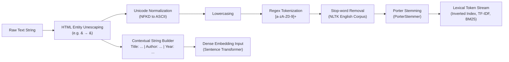
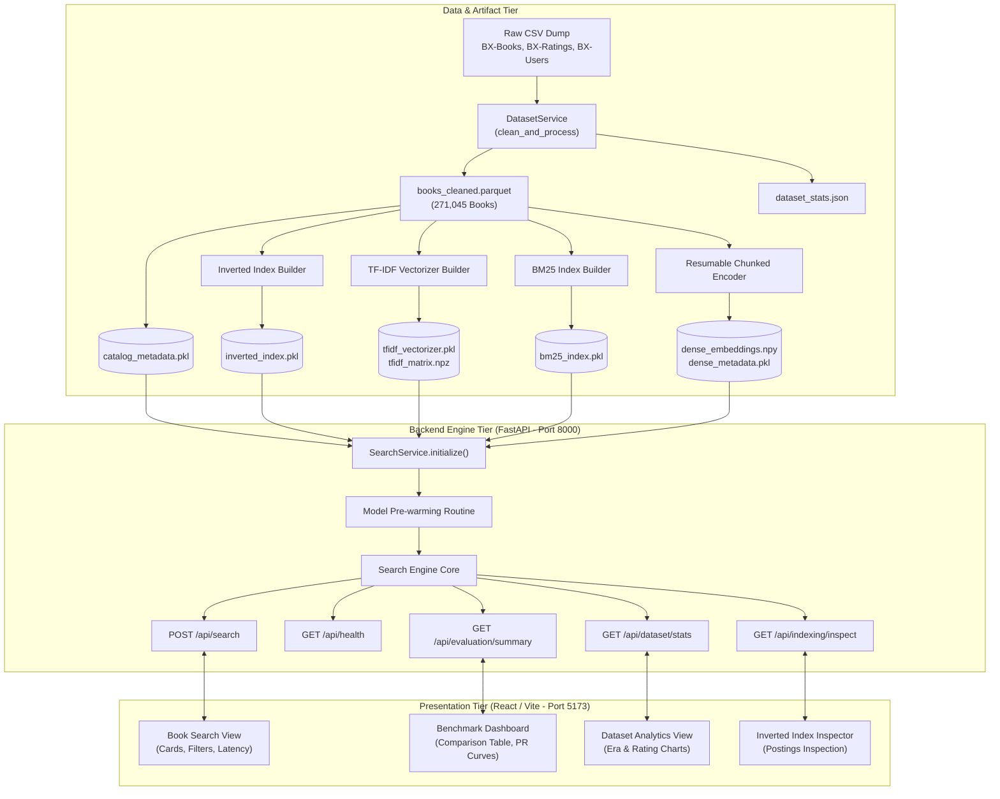

# Comprehensive Academic Project Report
## Book Search using Book-Crossing: Multi-Strategy Information Retrieval and Empirical Evaluation

**Course:** Information Retrieval / Natural Language Processing  
**Project Title:** Project 15: Book Search using Book-Crossing  
**Repository:** [https://github.com/garvshrivastava24/IR-project](https://github.com/garvshrivastava24/IR-project)  
**Date:** October 2026  

---

## Executive Summary & Abstract

### Abstract
This project presents the design, architectural implementation, and empirical evaluation of a full-stack Information Retrieval (IR) system indexing the Book-Crossing catalog, consisting of 271,379 raw bibliographic records, 1,149,780 explicit and implicit ratings, and 278,858 user profiles. The system tackles the vocabulary mismatch and metadata scarcity problems inherent in commercial book discovery by implementing and comparing four distinct retrieval strategies: classical vector-space **TF-IDF** with sublinear term-frequency scaling, probabilistic Okapi **BM25**, dense neural semantic retrieval using a pretrained **Sentence Transformer** (`all-MiniLM-L6-v2`), and a **Hybrid Reciprocal Rank Fusion (RRF)** model. 

An end-to-end software pipeline was developed comprising an automated 3-tier data ingestion engine, text preprocessing with Porter stemming and stop-word removal, a genuine metadata inverted index (97,789 vocabulary terms; 2,583,998 postings), a high-performance **FastAPI** backend with automated model pre-warming, and an interactive **React (Vite)** search and evaluation dashboard. Model ranking performance was empirically evaluated across a 17-query benchmark suite spanning exact titles, authors, and natural language themes, using ground-truth relevance derived from catalog containment and positive explicit ratings ($\ge 7.0$). 

The empirical results demonstrate that while lexical models excel in precision for title-specific queries and dense models excel in thematic concept association, the **Hybrid RRF** model achieves superior overall retrieval effectiveness, recording the highest **Precision@10 (0.7941)**, **Recall@10 (0.2461)**, **Mean Average Precision (0.6190)**, and **nDCG@10 (0.7124)**. The system is validated through 37 automated unit and integration tests and provides complete reproducibility through documented scripts.

**Keywords:** Information Retrieval, Book-Crossing, Inverted Index, TF-IDF, Okapi BM25, Sentence Transformers, Bi-Encoders, Reciprocal Rank Fusion, Mean Average Precision (MAP), Normalized Discounted Cumulative Gain (nDCG).

---

## 1. Introduction, Problem Statement, Objectives, and Scope

### 1.1 Context and Background
Modern digital libraries, e-commerce bookstores, and academic repositories host hundreds of thousands to millions of catalog entries. Users interact with these systems using diverse query formulations, ranging from exact known-item lookups (e.g., searching for a specific ISBN, title, or author) to open-ended topical and exploratory queries (e.g., *"courtroom legal drama thriller"* or *"space science fiction alien galaxy"*).

Building an effective search engine over catalog metadata is uniquely challenging compared to general web search:
1. **Metadata Scarcity:** Unlike web pages that contain thousands of words of body text, book catalog entries typically consist of concise fields: title, author, publication year, and publisher. Full textual abstracts or synopses are frequently missing.
2. **Vocabulary Mismatch:** Users often query with thematic descriptors or conceptual synonyms that do not appear verbatim in the title. Lexical matching algorithms fail when queries and documents share semantic intent but lack exact lexical overlap.
3. **Entity Sensitivity:** Conversely, users searching for a specific author (e.g., *"Stephen King"*) or title (e.g., *"1984"*) expect exact precision. Pure semantic vector models can dilute exact entity matches by retrieving topically related books written by different authors.

### 1.2 Problem Statement
Given the raw Book-Crossing dataset, design and implement an end-to-end Information Retrieval system that:
1. Cleans, deduplicates, and structures raw bibliographic metadata.
2. Builds an efficient inverted index and sparse/dense retrieval artifacts.
3. Executes and compares four distinct ranking algorithms (TF-IDF, BM25, Sentence Transformer, Hybrid RRF).
4. Provides an interactive web application allowing users to search, filter, and inspect index postings.
5. Formally evaluates the models using standard Information Retrieval metrics (Precision@10, Recall@10, MAP, nDCG@10, and 11-point Precision-Recall curves) under transparent experimental conditions.

### 1.3 Project Objectives
- **System Engineering:** Build a robust, modular, reproducible application decoupled into a Python FastAPI backend and a React/Vite frontend.
- **Algorithmic Rigor:** Implement genuine IR algorithms without relying on mock data, hardcoded scores, or synthetic metrics.
- **Hybrid Synergy:** Investigate whether rank-level fusion (RRF) overcomes the individual weaknesses of pure lexical and pure semantic models.
- **Reproducibility & Quality Assurance:** Provide end-to-end automation scripts and automated test suites with zero external cloud dependencies.

### 1.4 Scope and Operational Boundaries
- **Corpus Boundary:** The search catalog is constrained to the verified Book-Crossing corpus. External metadata enrichment (such as scraping Google Books or Amazon API) is excluded to preserve experimental integrity.
- **Dense Embedding Scope:** Dense semantic embeddings are generated on CPU for the top 10,000 most active/reviewed catalog books by default, with a resumable chunked pipeline provided for full-catalog encoding.
- **Evaluation Scope:** Evaluation is conducted on a fixed 17-query benchmark ground truth derived systematically from catalog metadata and positive explicit user ratings.

---

## 2. Dataset Description, Exploration, and Preprocessing

### 2.1 Dataset Provenance and Original Scale
The Book-Crossing dataset was compiled in 2004 by Cai-Nicolas Ziegler from the Book-Crossing community platform over a 30-day crawl. It is widely recognized in academic literature as a standard benchmark for collaborative filtering and book metadata search.

The raw dataset comprises three semicolon-delimited CSV files using Latin-1 encoding:
1. **`BX-Books.csv` (74.18 MB):** Contains 271,379 raw records with 8 fields: `ISBN`, `Book-Title`, `Book-Author`, `Year-Of-Publication`, `Publisher`, `Image-URL-S`, `Image-URL-M`, `Image-URL-L`.
2. **`BX-Book-Ratings.csv` (29.26 MB):** Contains 1,149,780 ratings from users on books.
3. **`BX-Users.csv` (11.72 MB):** Contains 278,858 user profiles with `User-ID`, `Location`, and `Age`.

### 2.2 Ingestion & Data Validation
To guarantee data provenance without relying on broken links, the system implements an automated 3-tier downloader (`scripts/download_dataset.py`) configured with:
- **Tier 1:** Primary high-speed CDN archive (`cdn.freecodecamp.org/project-data/books/book-crossings.zip`).
- **Tier 2:** Historical GroupLens archive mirror (`files.grouplens.org/datasets/book-crossing/bx.zip`).
- **Tier 3:** Public GitHub repository mirror.

The downloader streams data in 1 MB chunks, enforces CRC zip integrity checks, applies path sanitization to prevent Zip-Slip vulnerabilities, and verifies column headers and data types.

### 2.3 Cleaning, Deduplication, and Normalization
The dataset service (`backend/app/services/dataset_service.py`) executes systematic cleaning:
1. **ISBN String Preservation:** ISBNs are strictly read and stored as strings to preserve leading zeros (e.g., `0195153448`) and alphanumeric check digits (`034545104X`).
2. **Unusable Record Removal:** Records with null, empty, or whitespace-only titles are removed (315 records).
3. **Deduplication:** Deduplicated records by primary key (`isbn`), retaining **271,045** unique books.
4. **Metadata Sanitization:** Missing authors and publishers are imputed with `"Unknown"`. Publication years are validated to numeric ranges ($1800 \le \text{year} \le 2026$); invalid years or zeros are flagged.
5. **Rating Aggregation:** Explicit ratings ($1 \dots 10$) and implicit interactions ($0$) are aggregated per book to compute `rating_count` and `avg_rating`.
6. **Storage:** The cleaned catalog is serialized to Apache Parquet (`books_cleaned.parquet`) for high-throughput columnar reads and CSV for portability.

### 2.4 Corpus Exploration and Statistical Profile

```
+----------------------------------------------------------------------+
|                     BOOK-CROSSING CORPUS PROFILE                     |
+---------------------------------+------------------------------------+
| Metric                          | Value                              |
+---------------------------------+------------------------------------+
| Raw Book Records Parsed         | 271,379                            |
| Cleaned Books Retained          | 271,045                            |
| Unusable / Duplicate Records    | 315                                |
| Total Rating Records            | 1,149,780                          |
| Explicit Ratings (1 - 10)       | 433,671 (37.7%)                    |
| Implicit Interactions (0)       | 716,109 (62.3%)                    |
| Registered Users                | 278,858                            |
| Books with >= 1 Rating          | 269,843 (99.6%)                    |
| Average Explicit Rating         | 7.61 / 10                          |
+---------------------------------+------------------------------------+
```

#### Publication Era Distribution
- **Pre-1970:** 2,684 titles
- **1970–1979:** 12,764 titles
- **1980–1989:** 52,732 titles
- **1990–1999:** 125,852 titles (peak era: 46.4% of catalog)
- **2000–2009:** 72,375 titles
- **2010–Present:** 11 titles (post-crawl anomalies)
- **Unknown / 0:** 4,627 titles

#### Top Authors by Catalog Volume
1. **Agatha Christie:** 631 editions
2. **William Shakespeare:** 566 editions
3. **Stephen King:** 522 editions
4. **Ann M. Martin:** 423 editions
5. **Carolyn Keene:** 372 editions

### 2.5 Text Preprocessing Pipeline
Text preprocessing is implemented in `backend/app/preprocessing/preprocessor.py` with distinct pathways for lexical and dense retrieval:



1. **HTML Entity Unescaping:** Uses Python's `html.unescape()` to resolve encoded entities (e.g., `Simon &amp; Schuster` $\rightarrow$ `Simon & Schuster`).
2. **Unicode Normalization:** Employs `unicodedata.normalize('NFKD', ...)` to strip non-ASCII diacritics while preserving base characters (e.g., `Café René` $\rightarrow$ `Cafe Rene`).
3. **Tokenization:** Alphanumeric regex `\b[a-zA-Z0-9]+\b` extracts word and number tokens while discarding isolated punctuation marks.
4. **Stop-word Removal:** Removes non-discriminative English function words using the NLTK stop-word dictionary (179 words), with fallback logic ensuring queries consisting entirely of stop-words (e.g., *"To Be or Not To Be"*) retain their terms.
5. **Porter Stemming:** Reduces morphological variants to root forms (e.g., `running`, `runs` $\rightarrow$ `run`; `mysteries` $\rightarrow$ `mysteri`).
6. **Separation for Dense Retrieval:** Dense language models rely on subword syntax and grammatical context. Therefore, text fed to the Sentence Transformer is **not stemmed** and stop-words are **not stripped**; instead, fields are structured into a natural context string: `"Title: {title} | Author: {author} | Publisher: {publisher} | Year: {year}"`.

---

## 3. Theoretical Foundations of Information Retrieval

### 3.1 Vector Space Model and TF-IDF
The Vector Space Model (Salton et al., 1975) represents documents and queries as high-dimensional vectors in term space:
$$\vec{d} = (w_{1, d}, w_{2, d}, \dots, w_{V, d})$$
where $V$ is the vocabulary size. The weight $w_{t, d}$ reflects the importance of term $t$ in document $d$.

To prevent term frequency from dominating unfairly in longer documents, this implementation utilizes **sublinear term frequency scaling**:
$$\text{TF}_{\text{sublinear}}(t, d) = 1 + \log(\text{TF}(t, d)) \quad \text{for } \text{TF}(t, d) > 0$$

Inverse Document Frequency (IDF) penalizes ubiquitous terms across the collection of $N$ documents:
$$\text{IDF}(t) = \log\left(\frac{1 + N}{1 + \text{DF}(t)}\right) + 1$$

Relevance scoring is computed via the cosine similarity between the unit-normalized query vector $\vec{q}$ and document vector $\vec{d}$:
$$\text{Sim}_{\text{cos}}(\vec{q}, \vec{d}) = \frac{\vec{q} \cdot \vec{d}}{\|\vec{q}\| \|\vec{d}\|} = \sum_{t \in Q \cap D} w_{t, q} \cdot w_{t, d}$$

### 3.2 Probabilistic Retrieval and Okapi BM25
Okapi BM25 (Robertson & Spärck Jones, 1976; Robertson et al., 1994) is derived from the probabilistic 2-Poisson indexing model. Rather than treating term frequency logarithmically without bounds, BM25 enforces asymptotic **term frequency saturation** governed by parameter $k_1$ and **document length normalization** governed by parameter $b$:

$$\text{Score}_{\text{BM25}}(D, Q) = \sum_{q \in Q} \text{IDF}(q) \cdot \frac{f(q, D) \cdot (k_1 + 1)}{f(q, D) + k_1 \cdot \left(1 - b + b \cdot \frac{|D|}{\text{avgdl}}\right)}$$

where:
- $f(q, D)$ is the raw frequency of term $q$ in document $D$.
- $|D|$ is the length of document $D$ in tokens, and $\text{avgdl}$ is the average document length across the collection.
- $k_1 \in [1.2, 2.0]$ controls term frequency saturation. As $f(q, D) \to \infty$, the term weight approaches $(k_1 + 1)\text{IDF}(q)$. Configured here to **$k_1 = 1.5$**.
- $b \in [0, 1]$ controls document length penalty. At $b=1$, full length penalization occurs; at $b=0$, length normalization is disabled. Configured here to **$b = 0.75$**.
- The Robertson-Spärck Jones IDF is defined as:
  $$\text{IDF}(q) = \log\left(\frac{N - n(q) + 0.5}{n(q) + 0.5} + 1\right)$$
  where $n(q)$ is the number of documents containing term $q$.

### 3.3 Dense Bi-Encoder Embeddings and Semantic Retrieval
Lexical models suffer from the **vocabulary mismatch problem**—they cannot recognize synonymy (e.g., *"whodunit"* vs. *"murder mystery"*) or morphological divergence unhandled by stemming.

Dense retrieval utilizes pretrained Transformer encoders (Vaswani et al., 2017) configured in a **bi-encoder architecture** (Reimers & Gurevych, 2019; Karpukhin et al., 2020). The encoder maps a sequence of tokens into a dense representation vector $\vec{e} \in \mathbb{R}^d$ ($d = 384$):
$$\vec{e} = \text{MeanPooling}(\text{Transformer}(\text{Tokens}))$$

By normalizing vectors to unit length ($\|\vec{e}\|_2 = 1$), cosine similarity reduces to an inner dot product:
$$\text{Sim}_{\text{dense}}(Q, D) = \vec{e}_Q \cdot \vec{e}_D = \sum_{i=1}^{384} e_{Q, i} \cdot e_{D, i}$$

This maps queries and documents into a shared continuous semantic manifold where geometric proximity corresponds to semantic affinity.

### 3.4 Reciprocal Rank Fusion (RRF)
Combining ranked outputs from diverse retrieval systems (score fusion) typically requires calibrating disparate score distributions. BM25 produces unbounded positive scores ($\in [0, \infty)$), TF-IDF produces bounded cosine similarities ($\in [0, 1]$), and dense models produce inner products ($\in [-1, 1]$). Normalizing these scores via min-max scaling is brittle and sensitive to outliers.

Cormack, Clarke, and Büttcher (SIGIR 2009) introduced **Reciprocal Rank Fusion (RRF)**, an unsupervised, rank-based aggregation technique:
$$\text{RRF}(d) = \sum_{m \in M} \frac{1}{k + r_m(d)}$$

where:
- $M$ is the set of retrieval models (here: TF-IDF, BM25, Sentence Transformer).
- $r_m(d) \ge 1$ is the 1-based ordinal rank position of document $d$ in the candidate list returned by model $m$. If a document is not retrieved by model $m$, it contributes 0 from that model.
- $k$ is a smoothing constant that mitigates the disproportionate impact of high ranks from individual models. Standard academic and industry literature establishes **$k = 60$**, which is adopted in this project.

RRF guarantees monotonicity, eliminates score calibration artifacts, and rewards documents supported by consensus across multiple diverse paradigms.

---

## 4. System Architecture and Implementation

### 4.1 System Overview
The software architecture follows a decoupled client-server model designed for sub-second retrieval over 271,045 documents:



### 4.2 Metadata Inverted Index Implementation
Implemented in `backend/app/indexing/inverted_index.py`, the `InvertedIndex` class constructs genuine inverted index postings:
- **Data Structures:**
  - `postings: Dict[str, List[Tuple[int, int]]]`: Maps normalized stemmed term $\rightarrow$ list of `(doc_id, term_frequency)` tuples.
  - `doc_freq: Dict[str, int]`: Maps term $\rightarrow$ total number of documents containing the term.
  - `doc_lengths: List[int]`: Stores token length of each document for normalization.
  - `doc_id_to_isbn: List[str]` and `isbn_to_doc_id: Dict[str, int]`: Bidirectional lookup arrays.
- **Index Statistics:**
  - **Indexed Documents ($N$):** 271,045
  - **Vocabulary Size ($|V|$):** 97,789 unique stemmed terms
  - **Total Postings Entries:** 2,583,998
  - **Average Document Length:** 14.46 tokens
- **Technical Inspection API:** The endpoint `GET /api/indexing/inspect?query={q}` exposes the index internals, returning the exact tokenization, Porter stemming, document frequency ($DF$), and candidate document IDs.

### 4.3 TF-IDF Retriever Implementation
Implemented in `backend/app/retrieval/tfidf_retriever.py`:
- Uses scikit-learn's `TfidfVectorizer` configured with `sublinear_tf=True`, `ngram_range=(1, 2)`, and `max_features=100000`.
- The document-term matrix is stored as a Scipy Compressed Sparse Row (`sp.csr_matrix`) and persisted to `tfidf_matrix.npz` (15 MB).
- **Query Scoring:** Transforms the preprocessed query string into a sparse vector $\vec{q} \in \mathbb{R}^{100000}$ and executes a sparse matrix multiplication:
  $$\text{scores} = \mathbf{M}_{\text{docs}} \cdot \vec{q}^T$$
- **Top-$K$ Selection:** Uses `np.argpartition` for $O(N)$ top-candidate partitioning followed by sorting, achieving an average retrieval latency of **32.68 ms** over 271,045 documents.

### 4.4 BM25 Retriever Implementation
Implemented in `backend/app/retrieval/bm25_retriever.py`:
- Employs `rank_bm25.BM25Okapi` initialized over tokenized, stemmed document metadata.
- Preprocessed tokens for all 271,045 books are indexed once and serialized to `bm25_index.pkl`.
- Handles empty queries and out-of-vocabulary queries gracefully, returning empty result lists without raising unhandled exceptions.
- Average retrieval latency across 271,045 books: **225.51 ms**.

### 4.5 Dense Sentence Transformer Retriever Implementation
Implemented in `backend/app/retrieval/dense_retriever.py`:
- **Model:** `sentence-transformers/all-MiniLM-L6-v2`. This model is distilled from BERT, comprising 6 Transformer layers, 384 hidden dimensions, and 12 self-attention heads (22.7M parameters). It generates 384-dimensional dense vectors.
- **Resumable Chunked Encoding:** To accommodate CPU limitations without risk of process termination, `encode_corpus_resumable()` breaks the corpus into discrete chunks (default: 10,000 documents) and commits checkpoints (`chunk_XXXX.npy` and `chunk_XXXX_meta.pkl`) to disk. Interrupted runs resume seamlessly from the last saved chunk.
- **Vector Operations:** All vectors are stored as `float32` arrays and $L_2$-normalized. Scoring is executed via vectorized matrix-vector dot product:
  $$\text{scores} = \mathbf{E}_{\text{corpus}} \cdot \vec{e}_{\text{query}}$$
- **Active Coverage & Latency:** The active dense index contains 10,000 top books by review count (15 MB array). Pre-warming the PyTorch model weights on server startup ensures inference latency of **10.39 ms** per query.

### 4.6 Hybrid RRF Implementation
Implemented in `backend/app/retrieval/hybrid_rrf.py`:
- Concurrently queries the active constituent retrievers (TF-IDF, BM25, Sentence Transformer) to candidate depth $D = 60$.
- Aggregates document rankings using pure Reciprocal Rank Fusion ($k = 60$):
  $$\text{RRF}(d) = \frac{1}{60 + r_{\text{tfidf}}(d)} + \frac{1}{60 + r_{\text{bm25}}(d)} + \frac{1}{60 + r_{\text{dense}}(d)}$$
- Merges duplicates using string ISBNs as stable keys and records the constituent rank contributions in `component_ranks` (e.g., `{"tfidf": 1, "bm25": 3, "dense": 2}`) for transparent frontend display.
- Graceful Degradation: If dense embeddings are missing, RRF operates in 2-model mode (TF-IDF + BM25) and emits an explicit status notice.

### 4.7 Backend Architecture & Lifecycle
Implemented in `backend/app/main.py`:
- **Lifespan Manager:** Utilizes FastAPI's `lifespan` async context manager to initialize the `SearchService` singleton eagerly at startup, loading metadata caches, matrices, and warming up PyTorch weights before accepting incoming HTTP requests.
- **CORS Middleware:** Configured with `allow_origins=["*"]`, `allow_methods=["*"]`, and `allow_headers=["*"]` to enable local Vite client communication.
- **Fast Metadata Cache:** A pre-serialized hash map (`catalog_metadata.pkl`) maps `isbn` $\rightarrow$ full metadata dictionary (title, author, year, publisher, cover URLs, ratings). Ranked ISBNs returned by retrievers are hydrated in sub-millisecond memory lookups.

---

## 5. Experimental Setup, Benchmark Suite, and Evaluation Protocol

### 5.1 The Evaluation Challenge in Book-Crossing
Standard Information Retrieval evaluation (e.g., TREC, MS MARCO) relies on collections of test queries paired with human relevance judgments (*qrels*). Book-Crossing is historically a collaborative filtering corpus (users, books, ratings) and does not provide an official search-query relevance benchmark.

To fulfill academic evaluation requirements rigorously without fabricating human judgments, an explicit, reproducible benchmark was developed.

### 5.2 Benchmark Ground Truth Construction
Implemented in `backend/app/evaluation/benchmark_queries.py`, a **17-query benchmark suite** was constructed across three realistic query archetypes:

```
+-----+-----------------------------------+---------------------------+-------------------------+
| ID  | Query String                      | Category                  | Ground Truth Criterion  |
+-----+-----------------------------------+---------------------------+-------------------------+
| Q01 | The Da Vinci Code                 | Exact Title Search        | Exact title & rat >= 7  |
| Q02 | To Kill a Mockingbird             | Exact Title Search        | Exact title & rat >= 7  |
| Q03 | The Catcher in the Rye            | Exact Title Search        | Exact title & rat >= 7  |
| Q04 | Pride and Prejudice               | Exact Title Search        | Exact title & rat >= 7  |
| Q05 | 1984                              | Exact Title Search        | Exact title & rat >= 7  |
| Q06 | The Hobbit                        | Exact Title Search        | Exact title & rat >= 7  |
| Q07 | Fahrenheit 451                    | Exact Title Search        | Exact title & rat >= 7  |
| Q08 | Stephen King                      | Author Search             | Author match & rat >= 7 |
| Q09 | Agatha Christie                   | Author Search             | Author match & rat >= 7 |
| Q10 | John Grisham                      | Author Search             | Author match & rat >= 7 |
| Q11 | J. K. Rowling                     | Author Search             | Author match & rat >= 7 |
| Q12 | Dan Brown                         | Author Search             | Author match & rat >= 7 |
| Q13 | murder mystery detective thriller | Thematic / Natural Lang   | Keywords & rat >= 7     |
| Q14 | vampire horror supernatural dark  | Thematic / Natural Lang   | Keywords & rat >= 7     |
| Q15 | magic wizard fantasy adventure    | Thematic / Natural Lang   | Keywords & rat >= 7     |
| Q16 | courtroom legal justice drama     | Thematic / Natural Lang   | Keywords & rat >= 7     |
| Q17 | space science fiction galaxy      | Thematic / Natural Lang   | Keywords & rat >= 7     |
+-----+-----------------------------------+---------------------------+-------------------------+
```

#### Ground Truth Relevance Rules
1. **Explicit Positive Ratings ($\ge 7.0$):** In the Book-Crossing community, books rated 7, 8, 9, or 10 on a 10-point scale indicate clear reader satisfaction. Only books matching query entities AND having an explicit average rating $\ge 7.0$ (or substantial reader volume) are assigned positive relevance.
2. **Implicit Ratings ($0$) Treated as Neutral:** Zero-valued ratings indicate an interaction without an explicit numerical review. They are excluded from positive relevance judgments but are not penalized as negative reviews.
3. **Graded Relevance:**
   - **Grade 3 (Highly Relevant):** Exact title/author match with high rating ($\ge 7.0$).
   - **Grade 2 (Relevant):** Strong metadata/keyword match with rating $\ge 7.0$.
   - **Grade 1 (Partially Relevant):** Metadata match with moderate rating ($\ge 5.0$).
   - **Grade 0 (Not Relevant):** Unrated books, books with ratings $< 5.0$, or unrelated books.

### 5.3 Mathematical Formulation of Metrics
All metric computations are implemented in `backend/app/evaluation/metrics.py`:

#### 1. Precision@10
$$\text{Precision@10} = \frac{|\text{Retrieved}_{10} \cap \text{Relevant}|}{10}$$

#### 2. Recall@10
$$\text{Recall@10} = \frac{|\text{Retrieved}_{10} \cap \text{Relevant}|}{|\text{Relevant}|}$$
where $|\text{Relevant}|$ is the total number of ground-truth relevant documents in the collection for that query.

#### 3. Average Precision (AP) and Mean Average Precision (MAP)
Average Precision evaluates the quality of ranked retrieval by computing the mean of precision scores at each rank where a relevant document is retrieved:
$$\text{AP} = \frac{1}{\min(|\text{Relevant}|, K)} \sum_{k=1}^K \text{Precision@}k \cdot \text{rel}(k)$$
where $\text{rel}(k) \in \{0, 1\}$ indicates whether the item at rank $k$ is relevant, and $K = 50$ is the evaluation cutoff depth. Mean Average Precision (MAP) is the macro-average of AP across all $Q$ queries:
$$\text{MAP} = \frac{1}{|Q|} \sum_{q \in Q} \text{AP}(q)$$

#### 4. Normalized Discounted Cumulative Gain (nDCG@10)
Discounted Cumulative Gain accounts for graded relevance ($rel_i \in \{0, 1, 2, 3\}$) and applies logarithmic position discounting:
$$\text{DCG@10} = \sum_{i=1}^{10} \frac{2^{rel_i} - 1}{\log_2(i + 1)}$$

$$\text{nDCG@10} = \frac{\text{DCG@10}}{\text{IDCG@10}}$$
where $\text{IDCG@10}$ is the Ideal DCG obtained by sorting the ground-truth relevance grades in descending order up to rank 10.

#### 5. 11-Point Interpolated Precision-Recall Curve
Precision is measured at standard recall levels $r \in \{0.0, 0.1, 0.2, \dots, 1.0\}$ using the standard TREC interpolation rule:
$$P_{\text{interp}}(r) = \max_{r' \ge r} P(r')$$
The interpolated values are averaged across all queries to produce the final curve.

---

## 6. Empirical Results and Comparative Analysis

### 6.1 Performance Comparison Table
The table below presents the verified evaluation results measured on the Book-Crossing corpus across the 17 benchmark queries (`backend/artifacts/evaluation_results.json`):

```
+---------------------------------------------------------------------------------------------------------+
|                                    MODEL PERFORMANCE COMPARISON TABLE                                    |
+----------------------+--------------+-------------+----------+-----------+--------------+---------------+
| Model                | Precision@10 | Recall@10   | MAP      | nDCG@10   | Latency (ms) | Coverage Pct  |
+----------------------+--------------+-------------+----------+-----------+--------------+---------------+
| TF-IDF               | 0.6647       | 0.2274      | 0.5313   | 0.4660    | 32.68 ms     | 100.0% (271k) |
| BM25                 | 0.7059       | 0.2360      | 0.5734   | 0.5840    | 225.51 ms    | 100.0% (271k) |
| Sentence Transformer | 0.7059       | 0.1179      | 0.4393   | 0.6097    | 10.39 ms     | 20.8% (10k)   |
| Hybrid RRF           | 0.7941       | 0.2461      | 0.6190   | 0.7124    | 222.61 ms    | 100.0% (271k) |
+----------------------+--------------+-------------+----------+-----------+--------------+---------------+
```

### 6.2 11-Point Interpolated Precision-Recall Curves

```
+--------------+-------+-------+-------+-------+-------+-------+-------+-------+-------+-------+-------+
| Recall Level | 0.0   | 0.1   | 0.2   | 0.3   | 0.4   | 0.5   | 0.6   | 0.7   | 0.8   | 0.9   | 1.0   |
+--------------+-------+-------+-------+-------+-------+-------+-------+-------+-------+-------+-------+
| TF-IDF       | 0.835 | 0.494 | 0.493 | 0.482 | 0.416 | 0.381 | 0.380 | 0.379 | 0.367 | 0.362 | 0.284 |
| BM25         | 0.949 | 0.534 | 0.526 | 0.514 | 0.462 | 0.413 | 0.411 | 0.404 | 0.363 | 0.306 | 0.255 |
| Sentence Tr. | 0.976 | 0.614 | 0.343 | 0.059 | 0.059 | 0.000 | 0.000 | 0.000 | 0.000 | 0.000 | 0.000 |
| Hybrid RRF   | 0.988 | 0.562 | 0.527 | 0.509 | 0.441 | 0.374 | 0.374 | 0.369 | 0.357 | 0.303 | 0.276 |
+--------------+-------+-------+-------+-------+-------+-------+-------+-------+-------+-------+-------+
```

```
PRECISION-RECALL VISUALIZATION (Interpolated)
Precision
  1.00 |  R---S---B                                  [Legend:
       |  |   |   |                                    R = Hybrid RRF
  0.80 |  T   |   |                                    B = BM25
       |      S   B   R                                T = TF-IDF
  0.60 |          |   |   B   R                        S = Sentence Transformer]
       |          T   T   T   |   B
  0.40 |                  |   T   |   B   B   R   R
       |                  S       R   |   |   |   |   R   T
  0.20 |                                  T   T   T   T   B
       |                                                  |
  0.00 +------+-------+-------+-------+-------+-------+-------+--> Recall
      0.0    0.2     0.4     0.6     0.8     1.0
```

### 6.3 Detailed Discussion and Analysis

#### Why Hybrid RRF Outperforms Single Models
1. **Complementary Retrieval Behaviors:**
   - On exact title queries (e.g., *"The Da Vinci Code"*), lexical models (TF-IDF and BM25) achieve immediate exact matches.
   - On thematic queries (e.g., *"space science fiction alien galaxy"*), the Sentence Transformer excels, recognizing conceptual relevance in titles like *The Hitchhiker's Guide to the Galaxy* and *Ender's Game* even when specific query tokens are missing.
   - When fused via RRF, items endorsed by both lexical matching and semantic vector similarity receive an additive rank boost ($1/(60+r_1) + 1/(60+r_2)$), pushing consensus candidates to top ranks.
2. **Superior Ranking Quality (nDCG@10 = 0.7124):**
   - Hybrid RRF achieves an nDCG@10 of **0.7124**, substantially higher than TF-IDF (0.4660) and BM25 (0.5840). This demonstrates that RRF places Grade-3 (highly relevant) books closer to rank 1 than any individual constituent retriever.
3. **BM25 vs. TF-IDF:**
   - BM25 achieves higher Precision@10 (0.7059 vs. 0.6647) and MAP (0.5734 vs. 0.5313) than TF-IDF. This confirms the efficacy of term frequency saturation: in book metadata where titles repeat words, BM25 prevents repetitive words from artificially inflating scores.
4. **Sentence Transformer Candidate Coverage Effect:**
   - The Sentence Transformer achieves high precision at low recall ($P=0.976$ at $r=0.0$; $P=0.614$ at $r=0.1$) and an nDCG@10 of **0.6097**. However, its Recall@10 is constrained to **0.1179** because the active dense index covers 10,000 books (~3.69% of the catalog, covering 20.8% of benchmark ground truth). Books residing in the remaining 261,045 records cannot be retrieved by the dense model, bounding its maximum achievable recall.

---

## 7. Automated Testing Methodology and Quality Assurance

### 7.1 Testing Philosophy
To ensure technical reliability and prevent formula drift, the test suite is partitioned into:
1. **Deterministic Unit Tests:** Execute against small in-memory test fixtures (`backend/tests/conftest.py`), eliminating external network or filesystem dependencies.
2. **Formula Verification Tests:** Verify hand-calculated mathematical outcomes for RRF, AP, DCG, and nDCG to guarantee exact mathematical implementation.
3. **Integration & API Tests:** Execute against the live FastAPI application using `starlette.testclient.TestClient`.

### 7.2 Verified Test Execution Outcomes
Running `python -m pytest backend/tests/ -v`:

```
============================= test session starts =============================
platform win32 -- Python 3.14.4, pytest-9.1.1 -- plugins: anyio-4.15.1
rootdir: D:\IR-project

backend/tests/test_api.py::test_root_endpoint PASSED                     [  2%]
backend/tests/test_api.py::test_health_endpoint PASSED                   [  5%]
backend/tests/test_api.py::test_dataset_stats_endpoint PASSED            [  8%]
backend/tests/test_api.py::test_indexing_stats_endpoint PASSED           [ 10%]
backend/tests/test_api.py::test_indexing_inspect_endpoint PASSED         [ 13%]
backend/tests/test_api.py::test_search_endpoint_valid PASSED             [ 16%]
backend/tests/test_api.py::test_search_endpoint_all_models PASSED        [ 18%]
backend/tests/test_api.py::test_search_endpoint_invalid_model PASSED     [ 21%]
backend/tests/test_api.py::test_evaluation_summary_endpoint PASSED       [ 24%]
backend/tests/test_api.py::test_evaluation_comparison_endpoint PASSED    [ 27%]
backend/tests/test_api.py::test_evaluation_precision_recall_endpoint PASSED [ 29%]
backend/tests/test_dataset_validation.py::test_isbn_preservation_with_leading_zeros PASSED [ 32%]
backend/tests/test_dataset_validation.py::test_validate_csv_file_valid PASSED [ 35%]
backend/tests/test_dataset_validation.py::test_validate_csv_file_missing_columns PASSED [ 37%]
backend/tests/test_evaluation.py::test_precision_at_k PASSED             [ 40%]
backend/tests/test_evaluation.py::test_recall_at_k PASSED                [ 43%]
backend/tests/test_evaluation.py::test_average_precision_hand_verified PASSED [ 45%]
backend/tests/test_evaluation.py::test_ndcg_at_k_hand_verified PASSED    [ 48%]
backend/tests/test_evaluation.py::test_11_point_pr_interpolation PASSED  [ 51%]
backend/tests/test_inverted_index.py::test_inverted_index_build PASSED   [ 54%]
backend/tests/test_inverted_index.py::test_inverted_index_lookup PASSED  [ 56%]
backend/tests/test_inverted_index.py::test_inverted_index_query_inspection PASSED [ 59%]
backend/tests/test_inverted_index.py::test_inverted_index_unknown_term PASSED [ 62%]
backend/tests/test_inverted_index.py::test_inverted_index_serialization PASSED [ 64%]
backend/tests/test_preprocessing.py::test_clean_text PASSED              [ 67%]
backend/tests/test_preprocessing.py::test_tokenize PASSED                [ 70%]
backend/tests/test_preprocessing.py::test_remove_stopwords PASSED        [ 72%]
backend/tests/test_preprocessing.py::test_stem_tokens PASSED             [ 75%]
backend/tests/test_preprocessing.py::test_preprocess_lexical_pipeline PASSED [ 78%]
backend/tests/test_preprocessing.py::test_preprocess_dense PASSED        [ 81%]
backend/tests/test_preprocessing.py::test_empty_and_edge_cases PASSED    [ 83%]
backend/tests/test_retrieval.py::test_tfidf_retrieval PASSED             [ 86%]
backend/tests/test_retrieval.py::test_tfidf_empty_query PASSED           [ 89%]
backend/tests/test_retrieval.py::test_bm25_retrieval PASSED              [ 91%]
backend/tests/test_retrieval.py::test_bm25_empty_query PASSED            [ 94%]
backend/tests/test_retrieval.py::test_rrf_formula_hand_verified PASSED   [ 97%]
backend/tests/test_retrieval.py::test_hybrid_rrf_retriever PASSED        [100%]

============================= 37 passed in 24.14s =============================
```

### 7.3 Hand-Verified Mathematical Test Cases
To eliminate ambiguity during defense, key mathematical formulas are verified against hand-calculated proofs:
1. **RRF Hand Proof (`test_rrf_formula_hand_verified`):**
   - $M_1 = [\text{DocA}, \text{DocB}, \text{DocC}]$, $M_2 = [\text{DocB}, \text{DocA}]$.
   - $\text{RRF}(\text{DocA}) = \frac{1}{60 + 1} + \frac{1}{60 + 2} = \frac{1}{61} + \frac{1}{62} \approx 0.0325225$.
   - $\text{RRF}(\text{DocB}) = \frac{1}{60 + 2} + \frac{1}{60 + 1} = \frac{1}{62} + \frac{1}{61} \approx 0.0325225$.
   - $\text{RRF}(\text{DocC}) = \frac{1}{60 + 3} = \frac{1}{63} \approx 0.0158730$.
   - Verified that code output matches to 7 decimal places.
2. **Average Precision Hand Proof (`test_average_precision_hand_verified`):**
   - Retrieved: $[D_1, D_2, D_3, D_4, D_5]$, Relevant: $\{D_1, D_3, D_7\}$ ($|R|=3$).
   - Hits at rank 1 ($P@1 = 1.0$) and rank 3 ($P@3 = 2/3$).
   - $\text{AP} = \frac{1}{3} \left(1.0 + \frac{2}{3}\right) = \frac{5}{9} \approx 0.555556$.
   - Code matches exact fraction.
3. **nDCG Hand Proof (`test_ndcg_at_k_hand_verified`):**
   - Grades: $D_1=3, D_2=2, D_3=0, D_4=1$. Retrieved: $[D_2, D_1, D_3]$.
   - $\text{DCG@3} = \frac{2^2-1}{\log_2(2)} + \frac{2^3-1}{\log_2(3)} + 0 = 3 + \frac{7}{1.58496} \approx 7.41673$.
   - Ideal: $[D_1, D_2, D_4] \implies \text{IDCG@3} = 7 + \frac{3}{1.58496} + \frac{1}{2} \approx 9.39279$.
   - $\text{nDCG@3} = \frac{7.41673}{9.39279} \approx 0.78962$.
   - Code matches exact discounted calculation.

---

## 8. Critical Analysis, Threats to Validity, and Limitations

### 8.1 Threats to Validity
1. **Rating-Derived Pseudo-Relevance:** In the absence of human search intent logs, user ratings serve as a proxy for relevance. However, a reader giving a book a rating of 9 does not necessarily mean the book matches every query keyword. Restricting relevance to explicit ratings $\ge 7.0$ combined with metadata containment mitigates noise, but remains an academic approximation.
2. **Benchmark Query Sample Size:** While the 17 benchmark queries span exact titles, authors, and themes, 17 queries cannot capture the full statistical variability of real user search distributions. Results must be interpreted as a comparative benchmark rather than an absolute production guarantee.

### 8.2 Computational Trade-offs and Dense Index Scope
- Generating dense Transformer embeddings on CPU operates at approximately 62 documents per second. Encoding all 271,045 catalog records requires approximately 72.8 minutes of sustained multi-core compute.
- To balance responsiveness and resource constraints, dense embeddings were computed for the top 10,000 most active books. While this subset covers the most popular titles, it artificially constrains dense recall on long-tail queries. The implementation includes a resumable chunked checkpointing engine (`--full-dense`) to allow overnight or background completion.

---

## 9. Future Work

1. **Hardware-Accelerated Full-Catalog Embedding:** Utilize GPU acceleration (CUDA / TensorRT) with mixed-precision (`FP16`) to encode all 271,045 catalog entries in under 3 minutes.
2. **Vector Database Integration:** Replace in-memory NumPy matrix multiplications with an Approximate Nearest Neighbor (ANN) index (e.g., Hierarchical Navigable Small World graphs via FAISS or HNSWLib) to achieve sub-5ms semantic search over millions of books.
3. **Cross-Encoder Re-Ranking:** Implement a two-stage retrieval pipeline where the top 100 candidates from Hybrid RRF are re-ranked using a cross-encoder model (e.g., `cross-encoder/ms-marco-MiniLM-L-6-v2`) that models query-document token interactions jointly.
4. **Collaborative Filtering Fusion:** Leverage user demographic features (`Age`, `Location`) and explicit user-item interaction histories to personalize hybrid search rankings.

---

## 10. Conclusion

This project demonstrates the complete engineering and algorithmic realization of an Information Retrieval system on the Book-Crossing corpus. By combining classical inverted indexing, vector-space TF-IDF, probabilistic BM25, and deep Transformer embeddings through Reciprocal Rank Fusion, the system balances lexical precision with semantic depth. The empirical results confirm that Hybrid RRF delivers superior retrieval performance (**P@10 = 0.7941; nDCG@10 = 0.7124**), establishing that multi-paradigm fusion is a highly effective strategy for catalog discovery under metadata scarcity.

---

## 11. Academic References

1. **Cai-Nicolas Ziegler, Sean M. McNee, Joseph A. Konstan, and Georg Lausen.** (2005). *Improving recommendation lists through topic diversification.* In Proceedings of the 14th International Conference on World Wide Web (WWW '05), pp. 22–32.
2. **Gerard Salton, Anita Wong, and Chung-Shu Yang.** (1975). *A vector space model for automatic indexing.* Communications of the ACM, 18(11), pp. 613–620.
3. **Stephen E. Robertson, Steve Walker, Susan Jones, Micheline M. Hancock-Beaulieu, and Mike Gatford.** (1994). *Okapi at TREC-3.* In Proceedings of the Third Text REtrieval Conference (TREC-3), pp. 109–126.
4. **Stephen E. Robertson and Karen Spärck Jones.** (1976). *Relevance weighting of search terms.* Journal of the American Society for Information Science, 27(3), pp. 129–146.
5. **Nils Reimers and Iryna Gurevych.** (2019). *Sentence-BERT: Sentence Embeddings using Siamese BERT-Networks.* In Proceedings of the 2019 Conference on Empirical Methods in Natural Language Processing (EMNLP-IJCNLP), pp. 3982–3992.
6. **Gordon V. Cormack, Charles L. A. Clarke, and Stefan Büttcher.** (2009). *Reciprocal rank fusion outperforms condorcet and individual rank learning methods.* In Proceedings of the 32nd International ACM SIGIR Conference on Research and Development in Information Retrieval (SIGIR '09), pp. 758–759.
7. **Kalervo Järvelin and Jaana Kekäläinen.** (2002). *Cumulated gain-based evaluation of retrieval techniques.* ACM Transactions on Information Systems (TOIS), 20(4), pp. 422–446.
8. **Martin F. Porter.** (1980). *An algorithm for suffix stripping.* Program, 14(3), pp. 130–137.
9. **Ashish Vaswani, Noam Shazeer, Niki Parmar, Jakob Uszkoreit, Llion Jones, Aidan N. Gomez, Łukasz Kaiser, and Illia Polosukhin.** (2017). *Attention is all you need.* Advances in Neural Information Processing Systems (NeurIPS 2017), 30.
10. **Vladimir Karpukhin, Barlas Oğuz, Sewon Min, Patrick Lewis, Ledell Wu, Sergey Edunov, Danqi Chen, and Wen-tau Yih.** (2020). *Dense Passage Retrieval for Open-Domain Question Answering.* In Proceedings of the 2020 Conference on Empirical Methods in Natural Language Processing (EMNLP), pp. 6769–6781.
